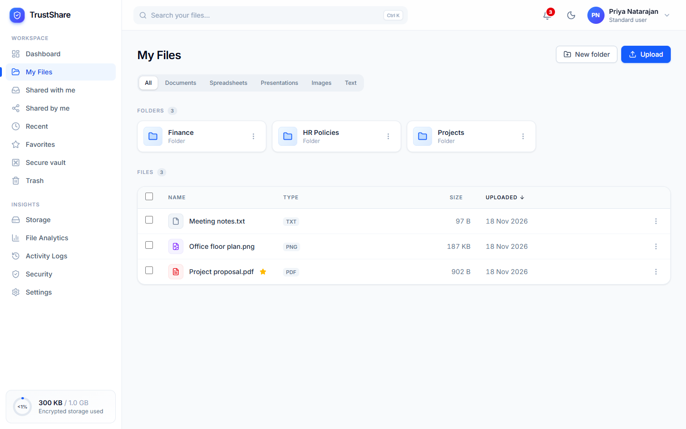
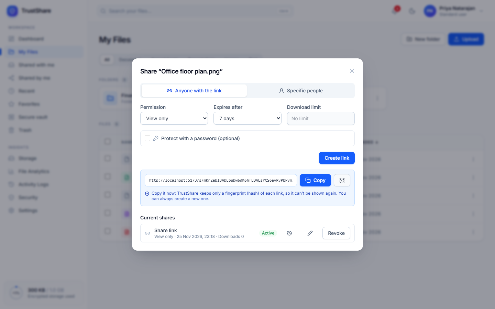
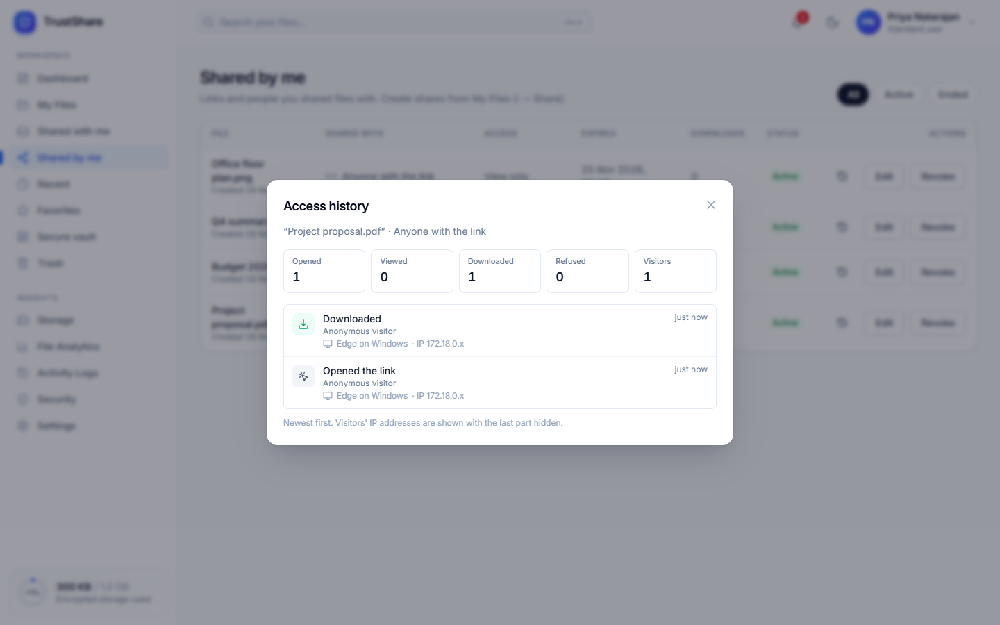
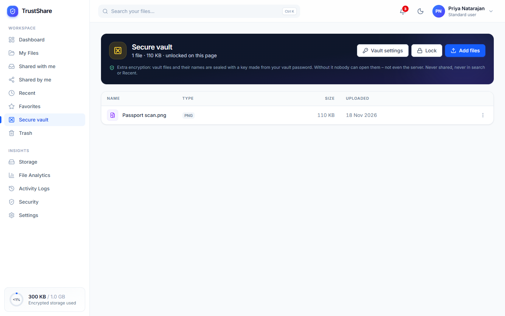
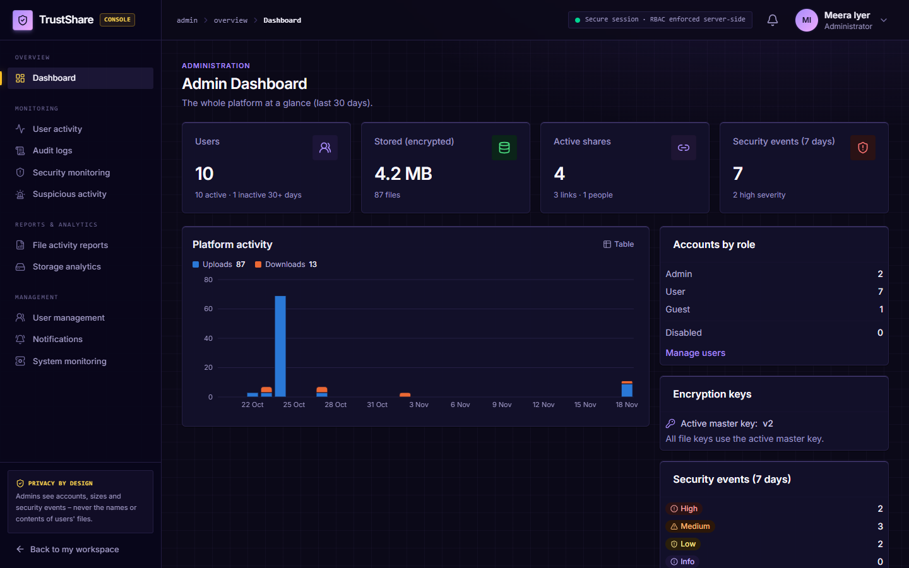
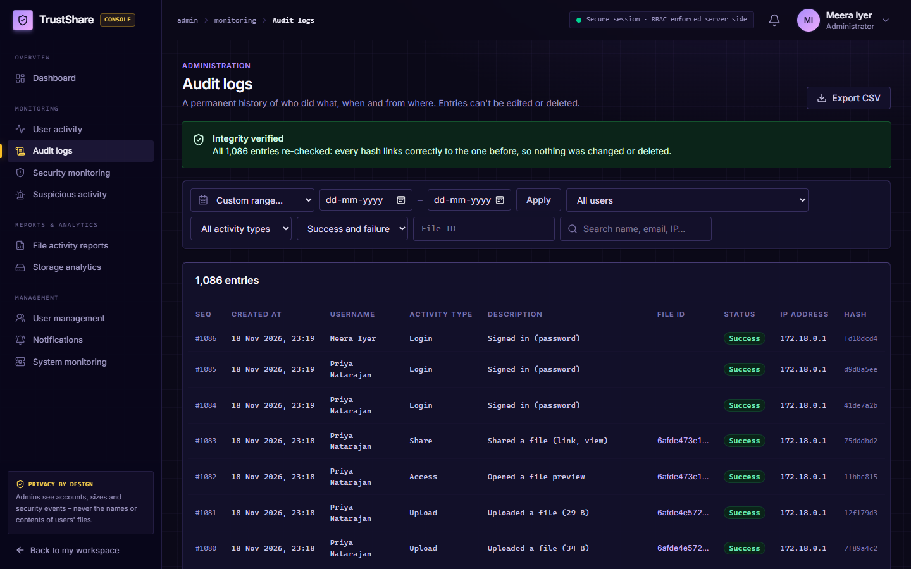
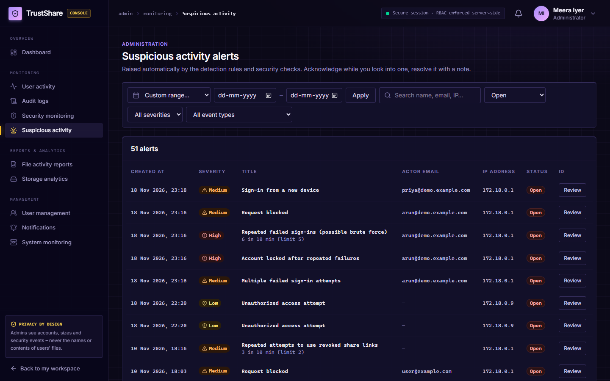
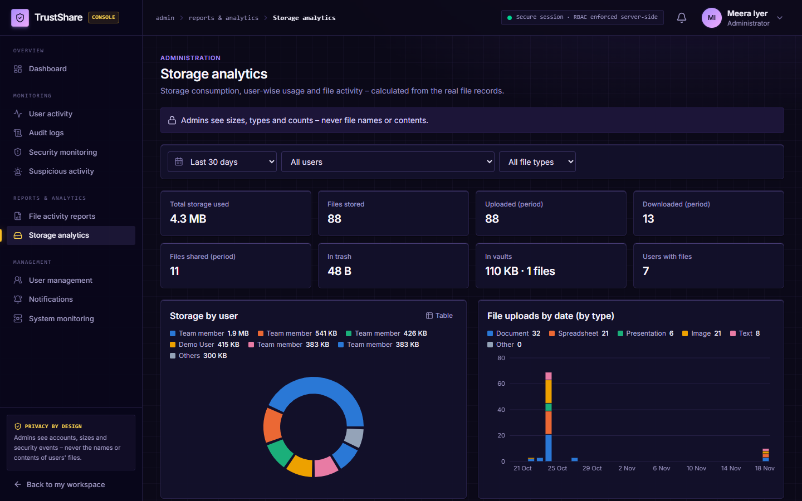
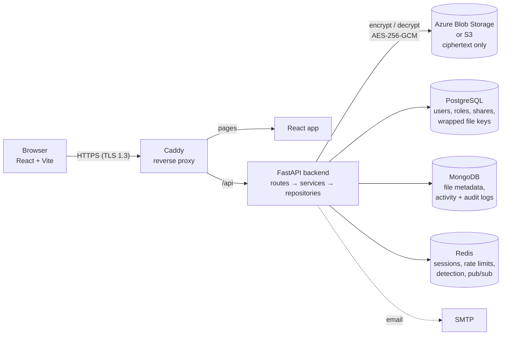

# TrustShare – Secure File-Sharing System

**A private, encrypted alternative to Google Drive.** Upload files, organise them in folders and
share them through expiring, permission-controlled links – every file is encrypted on the server
with its own AES-256 key, every action is recorded in a tamper-evident audit log, and suspicious
behaviour raises alerts in real time.

**Live:** [trustshare-vimal.centralindia.cloudapp.azure.com](https://trustshare-vimal.centralindia.cloudapp.azure.com) – running on Azure with Docker and HTTPS.


---

## Highlights

| | |
|---|---|
| 🔐 **Encryption at rest** | AES-256-GCM with a fresh key per file, envelope encryption with rotatable master keys; files live encrypted in Azure Blob Storage (or any S3-compatible store) |
| 🔗 **Secure sharing** | Links with view / download permission, expiry, download limits, optional password, instant revoke and QR code; direct sharing with registered users; access history per share |
| 👤 **Strong authentication** | JWT with rotating refresh tokens, two-step verification (TOTP + backup codes), Google sign-in, email verification, lockout and rate limiting, new-device alerts |
| 🛡️ **Role-based access** | Admin, User and Guest built from permissions; admins manage accounts but **can never see users' file names or contents** |
| 📜 **Tamper-evident audit log** | Every action recorded; each entry is SHA-256 hash-chained to the previous one, so any change or deletion is detected |
| 🚨 **Threat detection** | Rules for brute-force sign-ins, unauthorized access, mass downloads and abuse of expired or revoked links; alerts with an open → acknowledged → resolved workflow |
| 🔔 **Real-time notifications** | In-app (Server-Sent Events), email and desktop pop-ups: shares, downloads, expiring links, security warnings |
| 📊 **Analytics** | Storage, upload, download and sharing analytics for users; reports, storage analytics and a security dashboard for admins |
| 🗄️ **Secure vault** | A second, password-protected area with an extra layer of encryption for the most sensitive files |

The full list is in **[docs/features.md](docs/features.md)**.

## Screenshots

| | |
|---|---|
|  **My Files** – folders, sortable files, category filters |  **Secure sharing** – permission, expiry, limit, password, QR code |
|  **Access history** – who opened or downloaded a shared file |  **Secure vault** – a second password and extra encryption |
|  **Admin console** – never shows users' file names |  **Audit log** – hash-chained, integrity verified |
|  **Threat detection** – alerts with a review workflow |  **Storage analytics** |

Every screen, explained step by step: **[user guide](docs/user-guide.md)**.

## Architecture



Each store holds one kind of data – encrypted bytes, metadata and keys are kept apart, so no
single store reveals a file. More: [architecture](docs/architecture.md) ·
[database design](docs/database.md) · [encryption & key management](docs/key-management.md).

### How a file is protected

1. The file is uploaded over HTTPS and checked – type allow-list, real content (magic bytes), size and quota.
2. A new random 256-bit key is created for this file only.
3. The file is encrypted with AES-256-GCM in authenticated chunks and stored under a random name.
4. The file key is wrapped by the master key and stored in PostgreSQL; metadata goes to MongoDB.
5. On every download, permissions, link expiry, revocation and limits are checked again.
6. The file is decrypted in memory only, its integrity verified, and streamed to the user.

## Tech stack

| Layer | Technologies |
|---|---|
| Backend | Python 3.12, FastAPI, SQLAlchemy 2 (async), Pydantic v2, Alembic, Uvicorn |
| Frontend | React 19, Vite, Tailwind CSS, React Router, Axios, Recharts |
| Data | PostgreSQL 16, MongoDB 7, Redis 7 |
| Storage | Azure Blob Storage, S3 API (RustFS locally, AWS S3) |
| Security | AES-256-GCM (`cryptography`), bcrypt, JWT, TOTP, OAuth 2.0 + PKCE, TLS (Caddy) |
| Quality | pytest, Postman / Newman, ruff, ESLint, Prettier, pre-commit, GitHub Actions |
| Run | Docker and Docker Compose (7 services) |

## Quick start

Requires Docker Desktop.

```bash
git clone https://github.com/Vimaladharsan/TrustShare-Encrypted-File-Sharing-Collaboration-Platform.git
cd TrustShare-Encrypted-File-Sharing-Collaboration-Platform
cp .env.example .env            # then replace every "change-me" value
docker compose up -d --build
docker compose exec backend python -m app.scripts.create_admin --email you@example.com --name "Admin"
```

Open **https://localhost:8443**. API documentation: http://localhost:8000/docs.

Storage providers, HTTPS certificates, email, Google sign-in, demo data and all settings:
**[docs/setup.md](docs/setup.md)**.

## Documentation

| Document | What it covers |
|---|---|
| [Documentation index](docs/README.md) | Every document with a short description |
| [User guide](docs/user-guide.md) | How to use TrustShare – users and administrators, with screenshots |
| [Features](docs/features.md) | The complete feature list |
| [Project brief coverage](docs/brief-coverage.md) | Each item of the brief → where it is implemented and tested |
| [Setup and configuration](docs/setup.md) | Installation, storage, HTTPS, environment variables, tests, troubleshooting |
| [Deployment guide](docs/deployment.md) | Production setup and deployment to Azure with HTTPS |
| [API reference](docs/api.md) | Endpoints by module, with required permissions |
| [Architecture](docs/architecture.md) · [Database](docs/database.md) · [Key management](docs/key-management.md) | System design |
| [Requirements](docs/requirements.md) · [Wireframes](docs/wireframes.html) | Roles, permission matrix, user stories, UI plan |

## Testing

- **318 automated backend tests** (pytest) – authentication, encryption, sharing, access control,
  monitoring, notifications, analytics and an end-to-end scenario. 315 run anywhere; 3 Azure Blob
  tests run in CI against Microsoft's Azurite emulator.
- **Postman collections** for Milestones 2 and 3 – 77 requests, 126 checks.
- **GitHub Actions** runs linting, migrations, all tests and the production frontend build on every push.

```bash
docker compose exec backend pytest
```

## Project structure

```
backend/     FastAPI app – api/ (routes), services/, repositories/, models/, schemas/,
             storage/ (Azure / S3 + encryption), audit/, notifications/,
             security_monitoring/, reports/, analytics/ – plus alembic/ and tests/
frontend/    React app – pages/, components/, api/ (Axios client), auth/, theme/
caddy/       HTTPS reverse proxy configuration
docs/        Project documentation
postman/     API test collections
```

## Project status

| Milestone | Scope | Status |
|---|---|---|
| 1 | Design, setup, authentication, RBAC, MFA, secure upload, file dashboard | ✅ Complete |
| 2 | AES-256 encryption, cloud storage, secure sharing, key management, dashboards, HTTPS | ✅ Complete |
| 3 | Activity monitoring, audit logs, notifications, alerts, reports, analytics, threat detection | ✅ Complete |
| 4 | Security testing, cloud deployment, final documentation, demo | 🔄 Deployed and documented; security testing next |

> **Security note:** never commit `.env` files or secrets – `.env.example` lists every setting
> with placeholder values.

## License

MIT – see [LICENSE](LICENSE).

## Author

**S Vimaladharsan** – [GitHub](https://github.com/Vimaladharsan)
