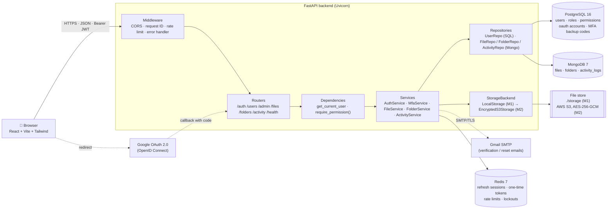
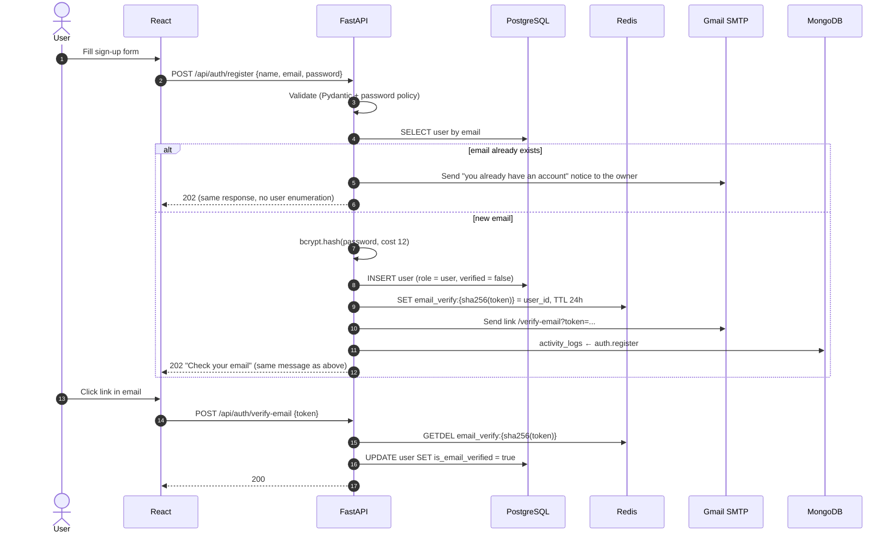
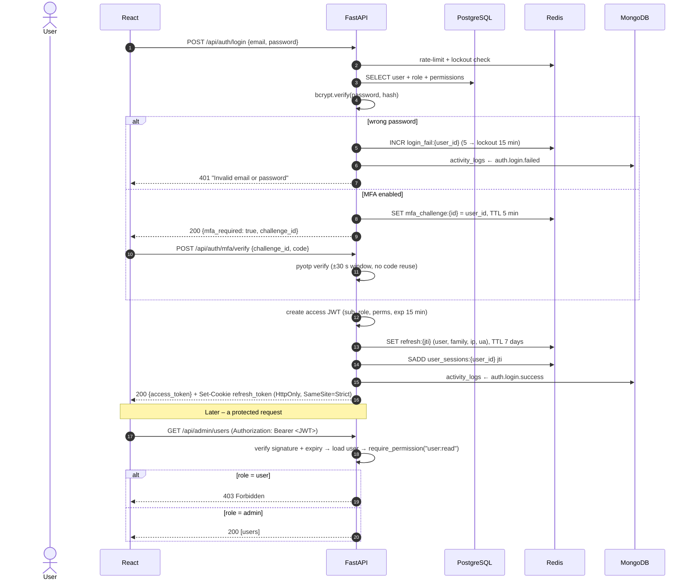
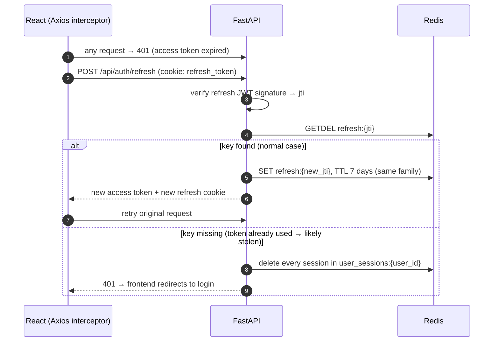
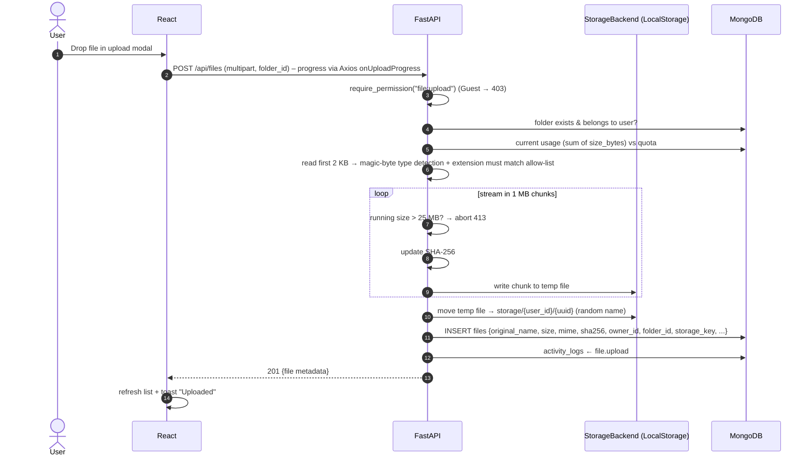
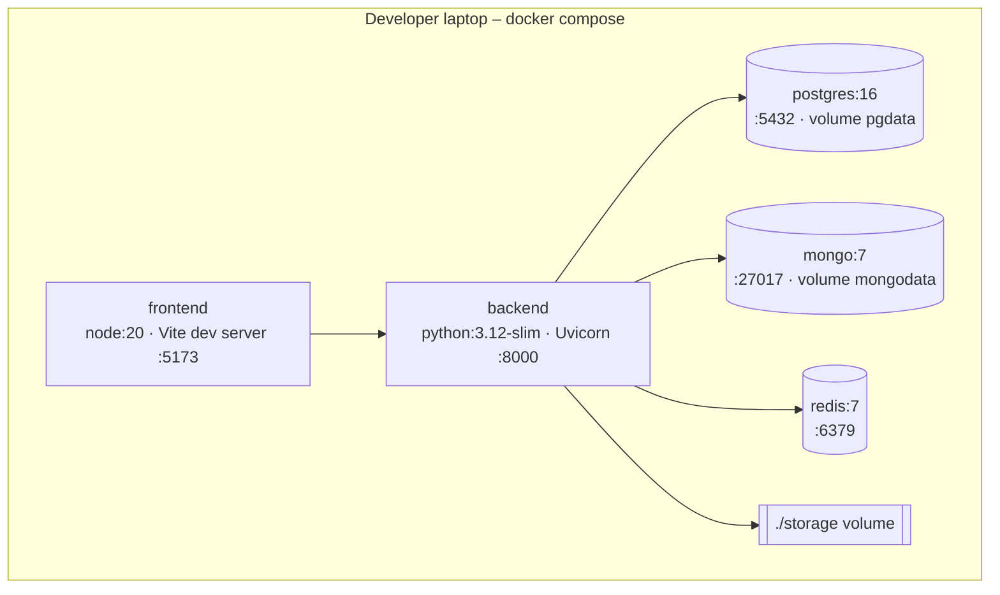
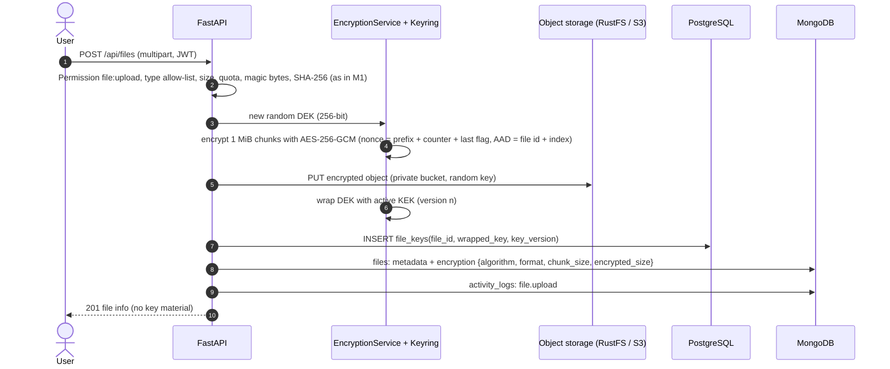
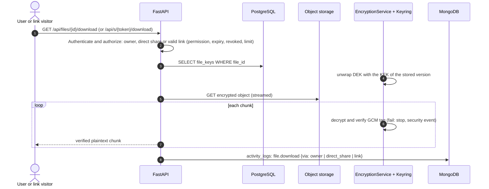
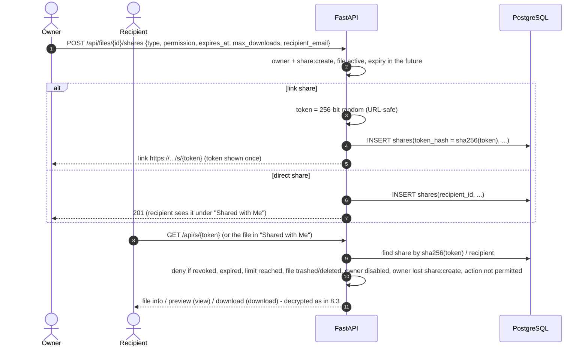

# TrustShare – System Architecture

> Diagrams use Mermaid and render directly on GitHub and in VS Code (Markdown Preview Mermaid Support extension).

## 1. Overview

TrustShare is a three-tier web application:

1. **Client** – a React single-page app (Vite + Tailwind). It only talks to the backend over HTTPS; it never touches a database or the file store.
2. **API** – a FastAPI backend. Every request is authenticated (JWT), authorised (permission check) and validated (Pydantic) before any data is touched.
3. **Data** – three databases, each chosen for what it is good at, plus a file store behind an interface.



### Why three databases?

| Store | Holds | Why this store |
|---|---|---|
| **PostgreSQL** | Users, roles, permissions, OAuth links, MFA backup codes. **(M2)** share links and permission grants. | Data that must be **consistent and relational**: unique emails, foreign keys (user → role), transactions. A wrong row here is a security bug, so we want strict schema and constraints. |
| **MongoDB** | File metadata, folders, activity/audit logs. | **High-volume, flexible documents**. File metadata varies by type (an image has dimensions, a PDF has page count, M2 adds encryption fields) – no migrations needed. Activity logs are append-only and grow fast. The M1 brief requires file metadata in MongoDB. |
| **Redis** | Refresh-token sessions, email-verify / reset / MFA-challenge tokens, rate-limit counters, lockouts. | Data that is **temporary and read on every request**. Redis keeps it in memory (sub-millisecond) and deletes it automatically with a **TTL**, so expired tokens clean themselves up. |

The detailed schema is in [database.md](database.md).

## 2. Backend layering

```
backend/app/
├── main.py            # create app, middleware, routers, lifespan (connect / disconnect DBs)
├── core/              # config (pydantic-settings), security (bcrypt, JWT), logging, errors
├── db/                # postgres.py (SQLAlchemy async engine), mongo.py (Motor), redis.py
├── models/            # SQLAlchemy ORM models (PostgreSQL tables)
├── schemas/           # Pydantic request / response models
├── repositories/      # data access only – no business rules
├── services/          # business rules – auth, MFA, OAuth, files, folders, activity, email
├── storage/           # StorageBackend interface + LocalStorage
├── api/
│   ├── deps.py        # get_current_user, require_permission("file:upload")
│   └── routes/        # auth.py, users.py, admin.py, files.py, folders.py, activity.py, health.py
└── tests/
```

**Rule:** routers handle HTTP only (parse, call a service, return a schema); services contain all decisions; repositories only read and write. This keeps every security decision in one testable place.

## 3. Request flows

### 3.1 Registration and email verification



### 3.2 Login with MFA, JWT issue and role check



### 3.3 Token refresh (rotation + reuse detection)



### 3.4 File upload



Rejected cases return clear errors with a machine-readable code: **415** `UNSUPPORTED_FILE_TYPE`, **413** `FILE_TOO_LARGE`, **413** `QUOTA_EXCEEDED`, **409** `DUPLICATE_FILE` (the UI offers "keep both"). A rejected upload's temp file is deleted immediately.

### 3.5 Google login (OAuth 2.0 Authorization Code flow)

```mermaid
sequenceDiagram
    autonumber
    actor U as User
    participant FE as React
    participant API as FastAPI
    participant R as Redis
    participant GG as Google
    participant PG as PostgreSQL

    U->>FE: Click "Continue with Google"
    FE->>API: GET /api/auth/google/login
    API->>R: SET oauth_state:{state}, TTL 10 min (CSRF protection)
    API-->>U: 302 → accounts.google.com (client_id, scope openid email profile, state)
    U->>GG: Sign in & consent
    GG-->>API: 302 /api/auth/google/callback?code&state
    API->>R: GETDEL oauth_state:{state} (must exist)
    API->>GG: exchange code → ID token; verify signature, audience, email_verified
    API->>PG: find oauth_account(google, sub) → else user by email → else create user
    API->>R: create refresh session (same as normal login)
    API-->>U: 302 → frontend /auth/callback (refresh cookie set) → frontend calls /auth/refresh
```

If the linked account has MFA enabled, the callback redirects to the MFA step instead of finishing the login.

Implementation notes: the authorization request also uses **PKCE** (S256; the code verifier is stored with the state in Redis), the ID token signature is checked against Google's published keys (`aud` = our client id, `iss` = Google), and errors (cancelled, expired state, unverified Google email, disabled account) redirect to `/login?oauth_error=…`.

## 4. API surface (Milestone 1)

All routes are under `/api`. Interactive docs: `http://localhost:8000/docs`.

| Method | Path | Permission | Purpose |
|---|---|---|---|
| GET | `/health` | public | Status of PostgreSQL, MongoDB, Redis |
| POST | `/auth/register` | public | Create account, send verification email |
| POST | `/auth/verify-email` | public | Confirm email with token |
| POST | `/auth/verify-email/resend` | logged in | Send a new verification link (soft mode by default: unverified users can log in; `REQUIRE_EMAIL_VERIFICATION=true` blocks them) |
| POST | `/auth/resend-verification` | public | Resend link (rate-limited) |
| POST | `/auth/login` | public | Password login → tokens or MFA challenge |
| POST | `/auth/mfa/verify` | public (challenge) | Second step with TOTP or backup code |
| POST | `/auth/refresh` | refresh cookie | Rotate refresh token, new access token |
| POST | `/auth/logout` | logged in | Revoke current session |
| POST | `/auth/logout-all` | logged in | Revoke all sessions |
| POST | `/auth/forgot-password` | public | Email reset link (always 202, same answer for unknown emails) |
| POST | `/auth/reset-password` | public (token) | Set new password, revoke sessions |
| GET | `/auth/google/login` · `/auth/google/callback` | public | Google OAuth |
| GET | `/users/me` | logged in | Profile, role, permissions, storage usage |
| PATCH | `/users/me` | logged in | Update name |
| POST | `/users/me/password` | logged in | Change password |
| POST | `/users/me/mfa/setup` · `/mfa/enable` · `/mfa/disable` · `/mfa/backup-codes` | logged in | Manage TOTP |
| GET | `/admin/users` | `user:read` | List/search users |
| PATCH | `/admin/users/{id}` | `user:manage` | Change role, activate/deactivate (not yourself; never the last admin) |
| POST | `/admin/users/{id}/unlock` | `user:manage` | Clear a login lockout early |
| GET | `/folders` · POST `/folders` | `file:read` · `folder:manage` | List children / create |
| PATCH · DELETE | `/folders/{id}` | `folder:manage` | Rename, move, trash |
| GET | `/folders/{id}/breadcrumbs` | `file:read` | Path to root |
| GET | `/files` | `file:read` | List with `folder_id, q, category, sort, order, page, trashed` |
| POST | `/files` | `file:upload` | Upload (multipart) |
| GET | `/files/{id}` · `/files/{id}/download` · `/files/{id}/preview` | `file:read` | Metadata / download / inline preview |
| PATCH | `/files/{id}` | `file:update` | Rename, move |
| POST | `/files/{id}/trash` · `/files/{id}/restore` | `file:update` | Soft delete / restore |
| DELETE | `/files/{id}` | `file:delete` | Permanent delete |
| GET | `/activity` | logged in (own) / `audit:read` (all) | Activity log |

**Error format** (every error):
```json
{ "error": { "code": "FILE_TOO_LARGE", "message": "File exceeds the 25 MB limit.", "request_id": "b1f2…" } }
```

## 5. Security design (M1)

| Threat | Control |
|---|---|
| Password database leak | bcrypt (cost 12, salted); passwords never logged. |
| Token theft | Access token lives 15 min in memory only (not localStorage); refresh token in **HttpOnly, SameSite=Strict** cookie, rotated on each use, reuse → revoke all. |
| Brute force / credential stuffing | Redis rate limit (e.g. 5 login attempts/min/IP), lockout after 5 failures, optional MFA. |
| User enumeration | Same response for "email exists"/"doesn't exist" on register, login, forgot-password. |
| Privilege escalation | Permission checked on **every** route via dependency; ownership checked in services; role cannot be set at registration. |
| Malicious upload | Allow-list + magic-byte check, 25 MB limit enforced while streaming, random stored names, files never executed or served with their original Content-Type unless safe; `Content-Disposition: attachment` for downloads; previews only for PDF/images/TXT/CSV, text always sent as `text/plain`, with `Content-Security-Policy: sandbox`; `X-Content-Type-Options: nosniff`. |
| Path traversal | Storage keys are server-generated UUIDs; user input never becomes a path. |
| CSRF (OAuth) | Random `state` stored in Redis, single use. |
| Secrets in code | `.env` (gitignored) loaded by pydantic-settings; `.env.example` documents keys. |
| Tampering / snooping on disk **(M2)** | Chunked AES-256-GCM with a per-file key; keys wrapped by versioned master keys (envelope encryption); the private bucket holds only ciphertext – see [§8](#8-milestone-2--encryption-storage-and-sharing) and [key-management.md](key-management.md). |

## 6. Deployment view (M1 – local)



All services have health checks; the backend waits for the databases to be healthy before starting. **(M4)** moves this to a cloud VM / AWS with NGINX + HTTPS.

## 7. Mapping to the brief's reference architecture

| Brief component | TrustShare implementation |
|---|---|
| Web App (React/Next.js) | React + Vite SPA |
| Admin Dashboard | Admin pages in the same SPA, gated by permissions |
| API Gateway: SSL, Auth, Validation, Rate limiting, Audit logging, Routing | FastAPI middleware + dependencies (NGINX/TLS added in M4) |
| Auth Service | `AuthService`, `MfaService`, `OAuthService` |
| File Service | `FileService`, `FolderService`, `StorageBackend` |
| Encryption Service | **M2** – `EncryptionService` + `Keyring` (chunked AES-256-GCM, envelope keys, rotation), `S3Storage` |
| Sharing Service | **M2** – `ShareService`: link + direct shares in PostgreSQL (hashed tokens, permission, expiry, revocation, limits) |
| Notification Service | Email (M1: verification/reset) → **M3** in-app + email alerts |
| Analytics Service | **M3** – aggregations over MongoDB activity logs |
| Data layer: PostgreSQL, MongoDB, Redis, encrypted storage, audit logs | As in §1 (audit logs = MongoDB `activity_logs`) |
| Infrastructure: Docker, CI/CD (GitHub Actions), AWS | Docker Compose + GitHub Actions now; cloud in M4 |
| Message queue, Kubernetes, SIEM/IDS, ML anomaly detection, mobile/desktop clients, FCM, Captcha | **Future scope** (see requirements §8) |

---

## 8. Milestone 2 – Encryption, storage and sharing

Requirements: Milestone 2 brief (AES-256 encryption, cloud storage, encrypted retrieval, secure sharing,
access permissions, link expiry, key management, secure decryption) plus the mentor's dashboards
(user File Analytics, admin Security Dashboard, user Security page). Key details:
[key-management.md](key-management.md).

### 8.1 Components added

| Component | Responsibility |
|---|---|
| `EncryptionService` | Chunked AES-256-GCM encrypt/decrypt of file streams; generates one DEK per file. |
| `Keyring` | Versioned master keys (KEKs) from the environment; wraps/unwraps DEKs. The only code that sees KEKs. |
| `S3Storage` (`StorageBackend`) | Upload/download/delete objects in a **private** bucket via the S3 API (boto3). RustFS locally, AWS S3 in the cloud. |
| `ShareService` | Link shares (hashed token) and direct shares (registered recipient); permission, expiry, revocation, download limit. |
| `AnalyticsService` | Date-range aggregations over activity logs and file metadata (user File Analytics, admin dashboards). |
| `SecurityEventService` | Records security events with severity (failed/locked logins, unauthorized and blocked requests, tampering, suspicious downloads). |

### 8.2 Encrypted upload



The plaintext never reaches object storage; the raw DEK never leaves backend memory.

### 8.3 Encrypted download / preview



### 8.4 Share links and direct sharing



| Situation | Result |
|---|---|
| Owner requests own file | Allowed (account active, file active) |
| Valid share, permitted action | Allowed – only that action (`view` = preview, `download` = preview + download) |
| Action not allowed by the permission (e.g. download on a view-only share) | 403 `SHARE_DOWNLOAD_NOT_ALLOWED` |
| Not the recipient of a direct share (incl. Admins) | 404 – nothing revealed |
| Link expired or revoked | 410 Gone ("This link has expired" / "This link was revoked") |
| Download limit reached | 410 Gone |
| File trashed, owner disabled or owner lost `share:create` | 404 – the link stops working automatically (works again if the file is restored and the link is still valid) |
| File deleted forever | 404 – its shares are deleted together with the object and key |

Link tokens: 256-bit random (`secrets.token_urlsafe(32)`), only the SHA-256 is stored, the full link is shown once; request logs print `/api/s/***`; the share page sets `Referrer-Policy: no-referrer`; public endpoints are rate-limited per IP (`SHARE_LINK_RATE_LIMIT_PER_MINUTE`). Download limits are counted with one atomic `UPDATE … WHERE download_count < max_downloads`, so two visitors can't both take the last download. Links must expire within `SHARE_LINK_MAX_DAYS` (30); direct shares may have no expiry.

### 8.5 Key rotation

Admin adds master key `v(n+1)` → sets it active → runs `rotate_keys` → every `file_keys` row on an older
version is unwrapped and re-wrapped with the new key (batches, idempotent) → old KEK removed when unused.
Files are never re-encrypted; downloads keep working during rotation.

### 8.6 Dashboards (mentor's additions)

- **User:** new sidebar (Dashboard, My Files, Shared with Me, Shared by Me, Recent, Favorites, Trash,
  Storage, File Analytics, Activity Logs, Security, Settings); File Analytics with summary cards, storage by
  type, uploads/downloads/sharing over time, recent uploads/downloads and a date range; a Security page
  describing the active protections.
- **Admin:** separate admin panel with a **Security Dashboard** – login metrics and charts, unauthorized
  and blocked attempts, security events by severity and type, recent logins with IP and location, audit
  log. Every admin endpoint requires the `audit:read` / `user:read` permissions on the **backend**; the
  hidden menu is only a convenience.

### 8.7 API surface added in Milestone 2 (planned)

| Method | Endpoint | Permission | Purpose |
|---|---|---|---|
| POST | `/files/{id}/shares` | `share:create` + owner | Create a link or direct share |
| GET | `/files/{id}/shares` | owner | List a file's shares with status |
| GET | `/shares/sent` · `/shares/received` | logged in | "Shared by Me" / "Shared with Me" |
| DELETE | `/shares/{share_id}` | owner | Revoke |
| GET | `/shares/{share_id}/preview` · `/shares/{share_id}/download` | recipient | Open a file shared with me |
| GET | `/s/{token}` · `/s/{token}/preview` · `/s/{token}/download` | public (token) | Link visitor access |
| POST/DELETE | `/files/{id}/favorite` | owner / recipient | Favorites |
| GET | `/analytics/me?from&to` | logged in | User File Analytics |
| GET | `/admin/security/overview?from&to` | `audit:read` | Security Dashboard metrics and charts |
| GET | `/admin/security/logins` · `/events` · `/audit` | `audit:read` | Recent logins, security events, audit log |

### 8.8 Deployment view (Milestone 2 – local)

`docker compose` gains a **`rustfs`** service (RustFS – open-source S3-compatible object storage, private bucket
created on start, console on :9001/rustfs/console/). Leaving `S3_ENDPOINT_URL` empty and putting real AWS credentials in `.env`
switches the same code to **AWS S3**. HTTPS locally is provided by a Caddy reverse proxy with a trusted
local certificate (Phase 9).
