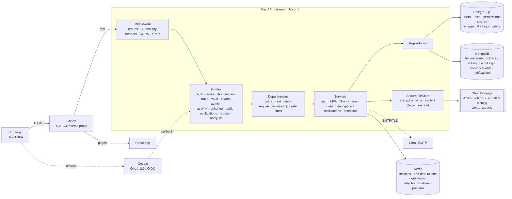
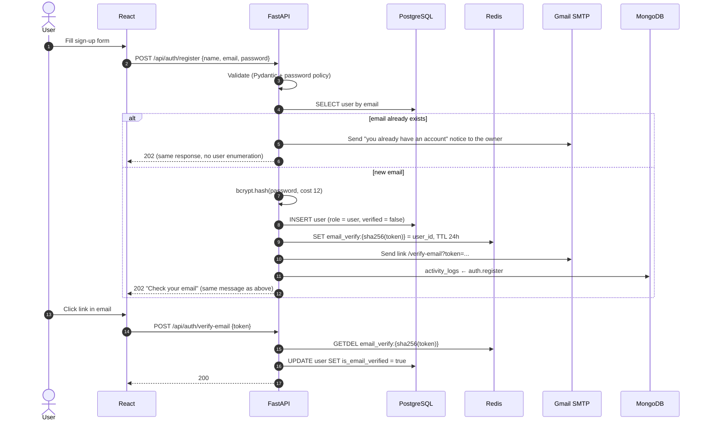
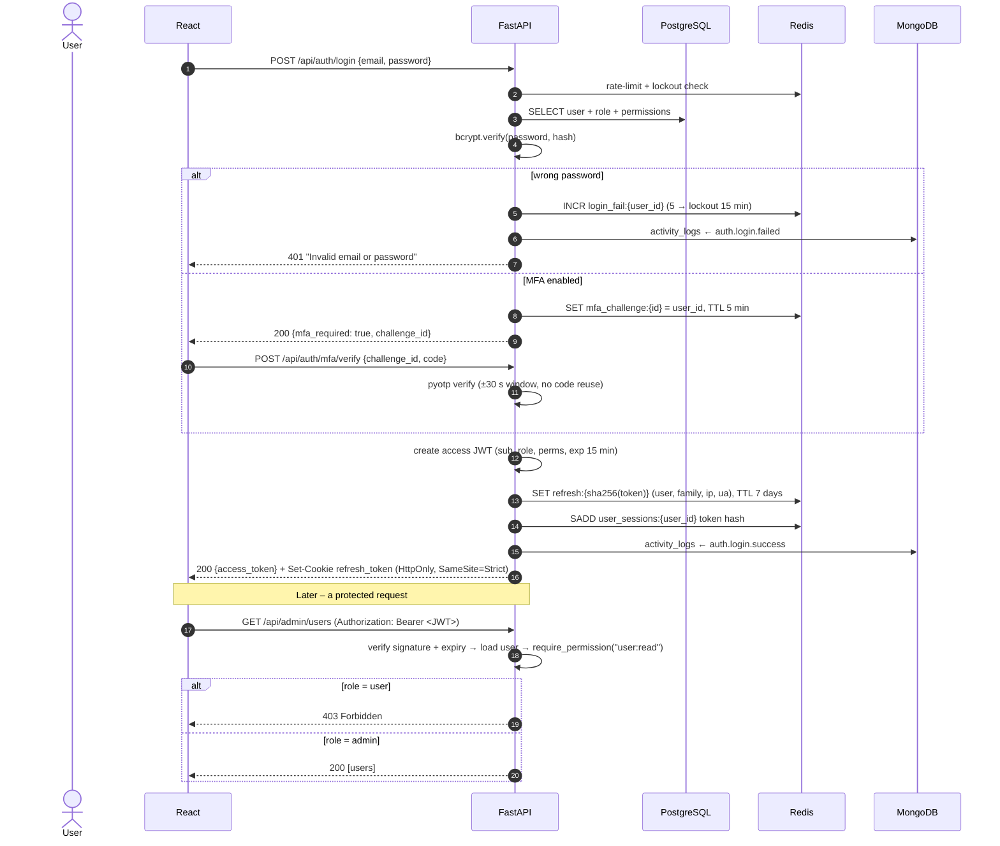
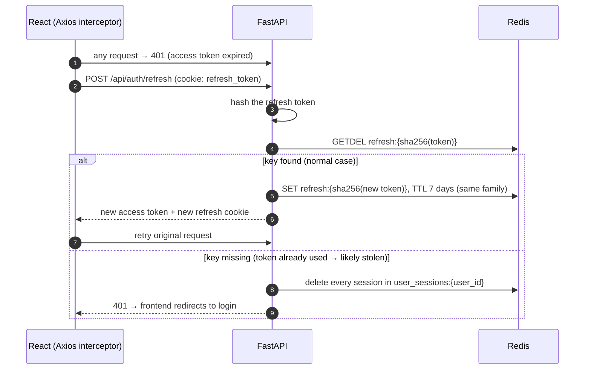
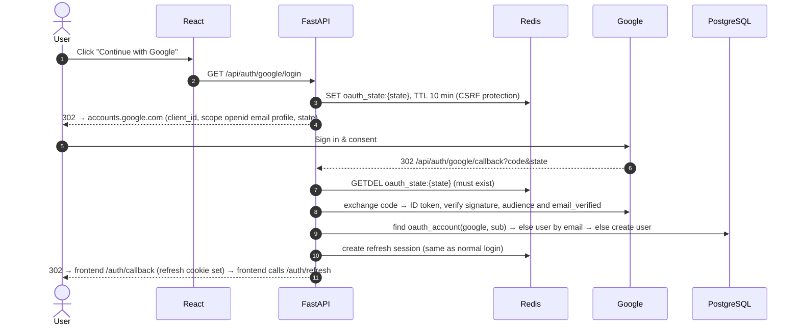
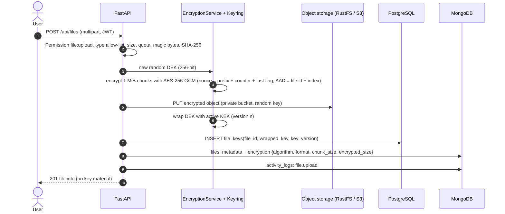
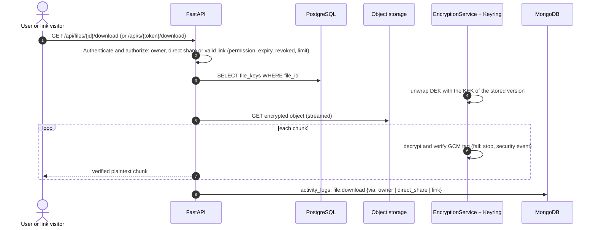
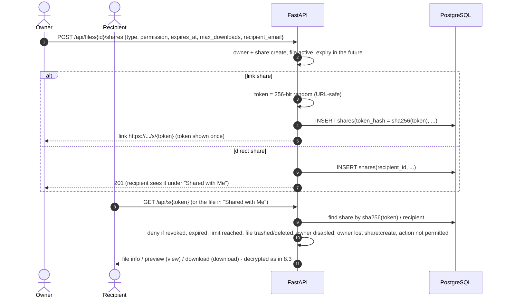
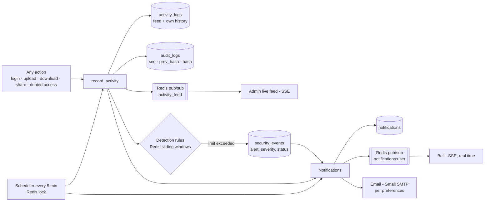
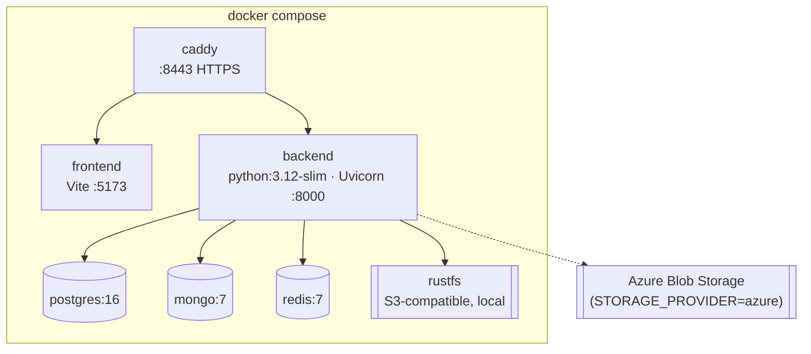

# TrustShare – System Architecture

> Final architecture after Milestones 1–3. Diagrams use Mermaid and render directly on GitHub.
> Related: [database design](database.md) · [encryption and key management](key-management.md) ·
> [API reference](api.md) · [brief coverage](brief-coverage.md).

## Contents

1. [Overview](#1-overview)
2. [Backend structure](#2-backend-structure)
3. [Frontend structure](#3-frontend-structure)
4. [Request flows](#4-request-flows) – registration, sign-in, token refresh, Google sign-in, encrypted
   upload, encrypted download, sharing, key rotation
5. [Monitoring, notifications and detection](#5-monitoring-notifications-and-detection)
6. [Security design](#6-security-design)
7. [Deployment view](#7-deployment-view)
8. [Mapping to the brief's reference architecture](#8-mapping-to-the-briefs-reference-architecture)

## 1. Overview

TrustShare is a three-tier web application behind an HTTPS reverse proxy:

1. **Client** – a React single-page app (Vite, Tailwind CSS). It talks only to the API; it never
   touches a database or the file store.
2. **API** – a FastAPI backend. Every request is authenticated (JWT), authorised (permission check)
   and validated (Pydantic) before any data is touched. Files are encrypted and decrypted here.
3. **Data** – three databases, each used for what it does best, plus private object storage that
   only ever holds ciphertext.



### Why three databases?

| Store | Holds | Why this store |
|---|---|---|
| **PostgreSQL** | Users, roles, permissions, OAuth links, MFA backup codes, shares, wrapped file keys, vaults | Data that must be **consistent and relational**: unique emails, foreign keys, transactions, constraints (e.g. a download limit counted atomically). A wrong row here is a security bug. |
| **MongoDB** | File and folder metadata, activity logs, hash-chained audit logs, security events, notifications, vault file metadata | **High-volume, flexible documents.** Logs are append-only and grow fast; metadata varies by file type. The Milestone 1 brief requires file metadata in MongoDB. |
| **Redis** | Refresh-token sessions, verification / reset / MFA / OAuth-state tokens (hashed), rate limits, lockouts, detection windows, pub/sub for real-time events | Data that is **temporary and read on every request** – kept in memory and deleted automatically with a TTL. |

**Separation of secrets:** encrypted bytes (object storage), metadata (MongoDB) and keys
(PostgreSQL, wrapped by master keys held only in the backend's environment) live in different
places, so no single store reveals a file. Schema details: [database.md](database.md).

## 2. Backend structure

```
backend/app/
├── main.py                # app, middleware, routers, lifespan (connect databases, start scheduler)
├── core/                  # settings, security (bcrypt, JWT), permissions, errors, logging, middleware, rate limits
├── db/                    # PostgreSQL (SQLAlchemy async), MongoDB, Redis connections
├── models/                # SQLAlchemy models (PostgreSQL tables)
├── schemas/               # Pydantic request / response models
├── repositories/          # data access only – no business rules
├── services/              # business rules: auth, MFA, OAuth, files, folders, trash, sharing, vault,
│                          #   encryption, analytics, security events, email, account deletion
├── crypto/                # master-key keyring (wraps / unwraps file keys), vault key derivation
├── storage/               # object storage adapters (S3, Azure Blob) + SecureFileStore
├── activity_monitoring/   # record_activity() – one recording function for every action; live feed
├── audit/                 # hash-chained audit_logs: filters, verify, CSV
├── security_monitoring/   # detection rules, alert workflow
├── notifications/         # notifications, triggers, SSE stream, background scheduler
├── reports/               # upload / download / sharing / user / security reports
├── analytics/             # admin storage analytics
├── api/                   # deps.py (get_current_user, require_permission) and routes/
└── scripts/               # create_admin, seed_demo, rotate_keys, copy_objects, remove_test_accounts …
```

**Rule:** routes handle HTTP only (parse, call a service, return a schema); services make every
decision; repositories only read and write. Every security decision therefore lives in one
testable place. Milestone 3 modules are named like the brief.

## 3. Frontend structure

```
frontend/src/
├── api/             # Axios client + one module per backend area
├── auth/            # AuthProvider: session resume, sign-in, MFA step, sign-out
├── notifications/   # NotificationsProvider: SSE stream, unread count, desktop pop-ups
├── theme/           # light / dark / system theme
├── components/      # layouts (workspace, admin console), file table, dialogs, charts …
└── pages/           # workspace pages, admin pages, public share page, auth pages
```

- **Access token in memory only** (never localStorage). The Axios client refreshes it once on a
  `401` and retries; concurrent requests share one refresh (a reused refresh token would end every
  session).
- **Permission-aware UI:** buttons and menus follow the user's permissions from `/api/users/me` –
  a convenience only; the backend enforces everything.
- **Two layouts:** the light/dark user workspace and a separate dark admin console, so admin mode is
  never mistaken for the workspace.
- Every page has loading, empty and error states and works at phone width.

## 4. Request flows

### 4.1 Registration and email verification



### 4.2 Sign-in with two-step verification, JWT and permission check



### 4.3 Token refresh, devices and sign-out



**Devices and per-device sign-out.** Every login starts a *session* (the refresh-token family, a random id). The id goes into each access token as the `sid` claim, and each refresh record keeps the browser, IP and `signed_in_at`. `GET /users/me/sessions` groups the refresh records by family (newest one wins) and marks the one matching the caller's `sid` as *This device*. `DELETE /users/me/sessions/{id}` deletes that family's refresh records and sets `revoked_sid:{id}` in Redis for 15 minutes (the access-token lifetime), so the signed-out device's access token is rejected on its very next request instead of working until it expires.

### 4.4 Google sign-in (OAuth 2.0 Authorization Code flow)



If the linked account has MFA enabled, the callback redirects to the MFA step instead of finishing the login.

Implementation notes: the authorization request also uses **PKCE** (S256; the code verifier is stored with the state in Redis), the ID token signature is checked against Google's published keys (`aud` = our client id, `iss` = Google), and errors (cancelled, expired state, unverified Google email, disabled account) redirect to `/login?oauth_error=…`.

### 4.5 Encrypted upload

Validation (permission `file:upload`, type allow-list, magic bytes and Office structure, 25 MB
streamed limit, quota, SHA-256) happens before encryption.



The plaintext never reaches object storage; the raw DEK never leaves backend memory.

Rejected cases return clear errors with a machine-readable code: **415** `UNSUPPORTED_FILE_TYPE`, **413** `FILE_TOO_LARGE`, **413** `QUOTA_EXCEEDED`, **409** `DUPLICATE_FILE` (the UI offers "keep both"). A rejected upload's temp file is deleted immediately.

### 4.6 Encrypted download and preview



### 4.7 Sharing



| Situation | Result |
|---|---|
| Owner requests own file | Allowed (account active, file active) |
| Valid share, permitted action | Allowed – only that action (`view` = preview, `download` = preview + download) |
| Action not allowed by the permission (e.g. download on a view-only share) | 403 `SHARE_DOWNLOAD_NOT_ALLOWED` |
| Not the recipient of a direct share (incl. Admins) | 404 – nothing revealed |
| Link expired or revoked | 410 Gone ("This link has expired" / "This link was revoked") |
| Download limit reached | 410 Gone |
| File trashed, owner disabled or owner lost `share:create` | 404 – the link stops working automatically (works again if the file is restored and the link is still valid) |
| File deleted forever | 404 – its shares are deleted together with the object and key |

Link tokens: 256-bit random (`secrets.token_urlsafe(32)`), only the SHA-256 is stored, the full link is shown once; request logs print `/api/s/***`; the share page sets `Referrer-Policy: no-referrer`; public endpoints are rate-limited per IP (`SHARE_LINK_RATE_LIMIT_PER_MINUTE`). Download limits are counted with one atomic `UPDATE … WHERE download_count < max_downloads`, so two visitors can't both take the last download. Links must expire within `SHARE_LINK_MAX_DAYS` (30); direct shares may have no expiry.

Edits (`PATCH /api/shares/{id}`) keep the same link; optional link passwords are bcrypt-hashed and
sent in the `X-Share-Password` header; every open, view, download and refused attempt is recorded
for the share's access history.

### 4.8 Key rotation

Admin adds master key `v(n+1)` → sets it active → runs `rotate_keys` → every `file_keys` row on an older
version is unwrapped and re-wrapped with the new key (batches, idempotent) → old KEK removed when unused.
Files are never re-encrypted; downloads keep working during rotation.

Details: [key-management.md](key-management.md).

## 5. Monitoring, notifications and detection

### 5.1 Modules

| Module | Responsibility |
|---|---|
| `app/activity_monitoring/` | `record_activity()` – the one reusable recording function; admin feed, summary, live stream |
| `app/audit/` | Append-only, hash-chained `audit_logs`; retrieval, filters, verification, CSV |
| `app/security_monitoring/` | `detection.py` rule engine; alert summary, filters and workflow |
| `app/notifications/` | Notifications + preferences, triggers, SSE stream, background scheduler, emails |
| `app/reports/` | Upload, download, sharing, user-activity and security reports (+ CSV) |
| `app/analytics/` | Admin storage analytics; shared query helpers (filters, file metadata without names) |

M1/M2 code stays layered (routes → services → repositories); `ActivityService.log` now simply delegates to
`record_activity`, so every existing call site feeds monitoring, audit, detection and notifications.

### 5.2 Event flow



### 5.3 Design decisions

- **Tamper-evident audit log.** `hash = SHA-256(prev_hash + canonical entry)`; a unique index on `seq` makes
  concurrent writers retry instead of forking the chain. `GET /api/audit-logs/verify` re-computes every hash and
  names the first broken entry. History recorded before M3 was imported once (`import_audit_history`, flagged
  `imported`).
- **Detection.** Each rule counts matching activities per subject (account, user or IP) in a Redis sorted set
  scored by time; above the limit → one security event, then a cooldown for the rest of the window. Thresholds
  come from `.env`. Every security event is also an alert with a status (open → acknowledged → resolved).
- **Real-time delivery with Server-Sent Events.** One long-lived response per tab, fed by Redis pub/sub. The
  browser reads it with `fetch` and the in-memory access token in the Authorization header (no token in the URL).
  The server ends the stream with `reauth` when the token expires or the device is signed out, the client
  refreshes and reconnects; a heartbeat every 25 s keeps proxies (Caddy) from closing it.
- **Background scheduler.** A task started with the API (Redis lock → only one copy runs) sends expiry reminders
  24 h before a share expires and records `share.expired` once.
- **Privacy.** Admin reports, analytics, logs and alerts return file IDs, types and sizes – never names
  (`activity_monitoring.models.redact`, name-free audit descriptions). This is a deliberate deviation from the
  brief's "filter by file name", in line with the M2 rule that admins cannot see users' files.
- **Storage of file metadata.** The brief assumes file metadata in PostgreSQL; TrustShare keeps it in MongoDB
  (Milestone 1 requirement), so analytics read MongoDB `files`/`vault_files` and PostgreSQL `users`/`shares`.

### 5.4 Admin console

Overview · **Monitoring** (user activity with live feed, audit logs with integrity banner, security
monitoring, suspicious-activity alerts) · **Reports & analytics** (file activity reports, storage
analytics) · **Management** (users, notifications, system). Every admin endpoint requires
`audit:read` or `user:read` / `user:manage` on the backend; the hidden menu is only a convenience.

## 6. Security design

| Threat | Control |
|---|---|
| Storage or database leak | Files encrypted with AES-256-GCM, one key per file; keys stored only wrapped by master keys kept outside the databases; vault files sealed again with a key from the vault password |
| Tampered files | Authenticated encryption per chunk; any changed, missing or reordered chunk stops the download and raises a security event |
| Tampered logs | Audit entries hash-chained (SHA-256); verification names the first broken entry |
| Password database leak | bcrypt (cost 12, salted); passwords never logged |
| Token theft | Access token 15 min, in memory only; refresh token HttpOnly + SameSite cookie, rotated on every use, reuse ends every session; per-device sign-out takes effect immediately |
| Brute force / credential stuffing | Per-IP rate limits, lockout after 5 failures, two-step verification, brute-force detection alerting admins |
| Account enumeration | Same answer for existing and unknown emails on registration, sign-in and password reset |
| Privilege escalation | Permission checked on every route; ownership checked in services; other users' files answer `404`; role can't be chosen at registration; admins have no file permission over other users |
| Link guessing or leaks | 256-bit random tokens stored only as hashes and masked in logs; expiry, download limits, optional password, instant revoke; every access re-checked |
| Malicious uploads | Allow-list + magic-byte and Office-structure check, streamed size limit, random stored names; downloads as attachments; previews only for safe types, sandboxed |
| Interception | TLS 1.3 through Caddy |
| Cached sensitive responses | `Cache-Control: no-store` on every API response |
| Clickjacking / MIME sniffing | `X-Frame-Options: DENY`, `X-Content-Type-Options: nosniff` |
| CSRF on OAuth | Random `state` (single use) + PKCE |
| Secrets in code | `.env` (gitignored), `.env.example` documents every key |

## 7. Deployment view

Local development and the current setup: one `docker compose` project with **7 services**.



All services have health checks; the backend waits for the databases and runs migrations on start.
Uvicorn trusts `X-Forwarded-For` only from proxies inside the Docker network, so logs and rate
limits see the visitor's real IP. Production runs the same stack with `docker-compose.prod.yml` on an Azure VM –
see the [deployment guide](deployment.md).

## 8. Mapping to the brief's reference architecture

| Brief component | TrustShare |
|---|---|
| Web app (React / Next.js), admin dashboard | React + Vite SPA with a separate admin console |
| API gateway: SSL termination, routing | Caddy |
| Gateway: authentication, validation, rate limiting, audit logging | FastAPI dependencies and middleware |
| Auth, file, encryption, sharing, notification, analytics services | Backend modules (sections 2 and 5) |
| Message queue / event bus | Redis pub/sub and an in-process scheduler |
| PostgreSQL, MongoDB, Redis, encrypted storage, audit logs | As in section 1 |
| Docker, CI/CD | Docker Compose, GitHub Actions |
| AWS / Azure | Azure Blob Storage for files; cloud hosting in Milestone 4 |
| Kubernetes, SIEM / IDS, ML anomaly detection, mobile / desktop apps, FCM, captcha | Future work |

Item-by-item coverage: [brief-coverage.md](brief-coverage.md).
