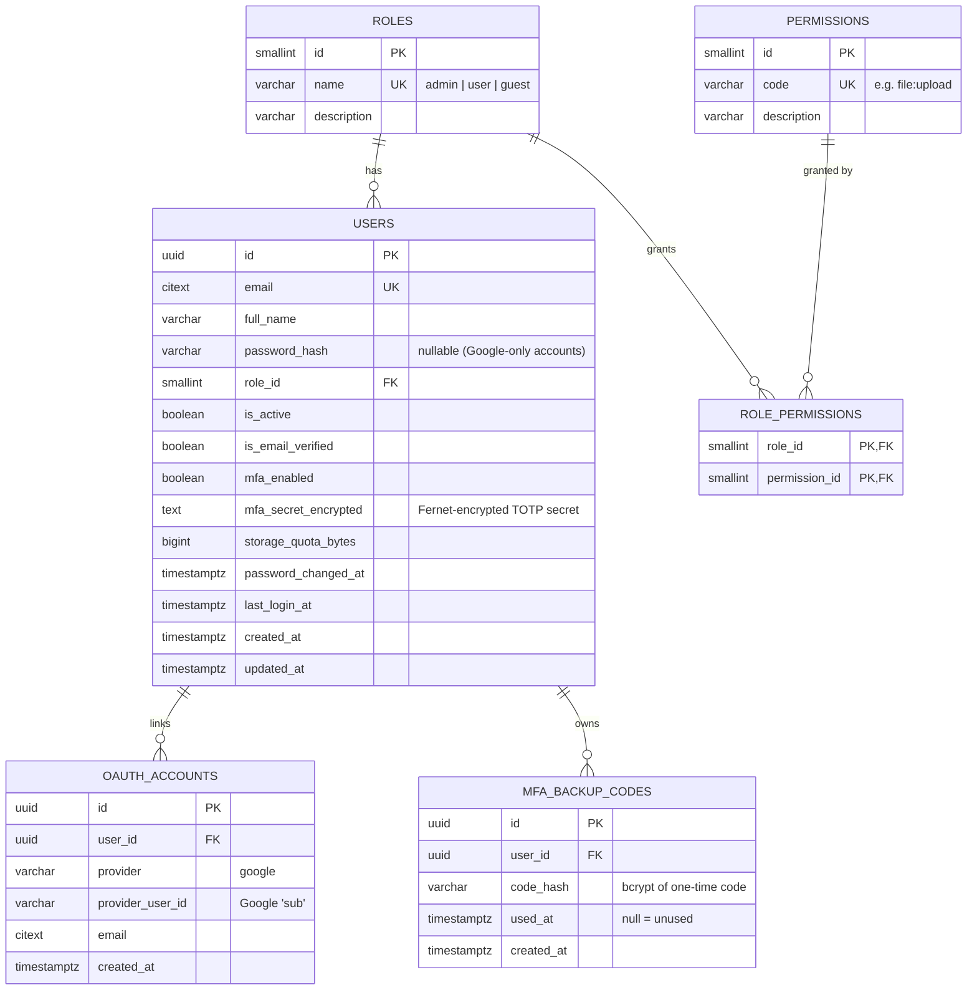

# TrustShare – Database Design

Three stores, each used for what it does best (see [architecture.md](architecture.md#why-three-databases)).

| Store | Data |
|---|---|
| PostgreSQL | Identity & authorisation: users, roles, permissions, OAuth links, MFA backup codes. **(M2)** shares. |
| MongoDB | File metadata, folders, activity / audit logs. |
| Redis | Short-lived security state: refresh sessions, one-time tokens, rate limits, lockouts. |

### Data placement rationale (read this before the viva)

The M1 brief is slightly inconsistent: its intro says file details go in PostgreSQL, while Step 4, the expected outcomes and the **graded checklist** say file metadata goes in **MongoDB**. The full brief's M2 workflow says "metadata **and permissions** in PostgreSQL".

TrustShare follows the graded checklist and resolves the rest by data type:

- **Who may do what** (accounts, roles, permissions, and from M2 share grants) → **PostgreSQL**, because authorisation needs foreign keys, uniqueness and transactions.
- **Describing files** (name, size, type, hash, folder, version, later encryption info) → **MongoDB**, because the shape varies per file type and evolves each milestone without migrations.
- The two are joined by IDs: Mongo documents store the PostgreSQL `user_id` (UUID) as `owner_id`; M2 share rows store the Mongo `file_id`.

The cross-database link is safe because every write path goes through one service (e.g. `FileService`), and the user ID is immutable.

---

## 1. PostgreSQL (relational)

### 1.1 ER diagram



### 1.2 Tables

**`roles`** – seeded by migration.

| id | name | description |
|---|---|---|
| 1 | admin | Full platform administration |
| 2 | user | Standard member, manages own files |
| 3 | guest | Read-only access |

**`permissions`** – seeded by migration: `file:read`, `file:upload`, `file:update`, `file:delete`, `folder:manage`, `user:read`, `user:manage`, `audit:read`, `share:create` (M2), `user:delete_inactive` (M2). The M1 permission `file:read_all` was removed in M2 – admins can't read users' files.

**`role_permissions`** – mapping from the permission matrix in [requirements.md](requirements.md#3-permission-matrix).

**`users`**

| Column | Type | Constraints / notes |
|---|---|---|
| id | `uuid` | PK, generated server-side (`uuid4`). UUIDs don't reveal how many users exist and can't be guessed. |
| email | `citext` | `UNIQUE NOT NULL` – case-insensitive, so `A@x.com` = `a@x.com`. |
| full_name | `varchar(100)` | `NOT NULL` |
| password_hash | `varchar(255)` | bcrypt hash; `NULL` for accounts created only through Google. |
| role_id | `smallint` | FK → roles, default `2` (user). Not settable by the client at sign-up. |
| is_active | `boolean` | default `true`; admin can deactivate. |
| is_email_verified | `boolean` | default `false`; `true` for Google sign-ups (Google verified it). |
| mfa_enabled | `boolean` | default `false` |
| mfa_secret_encrypted | `text` | TOTP secret, encrypted with a server key (Fernet). Even a DB dump does not reveal it. |
| storage_quota_bytes | `bigint` | default 1 GB (from env). Usage is computed from MongoDB, not stored twice. |
| password_changed_at | `timestamptz` | Access tokens issued before this time are rejected. |
| last_login_at, created_at, updated_at | `timestamptz` | |

Indexes: `UNIQUE(email)`, `INDEX(role_id)`.

**`oauth_accounts`** – `UNIQUE(provider, provider_user_id)`, `INDEX(user_id)`, `ON DELETE CASCADE`.

**`mfa_backup_codes`** – 10 rows per user when MFA is enabled; regenerating deletes old rows. `INDEX(user_id)`, `ON DELETE CASCADE`.

**`file_keys`** *(Milestone 2)* – one row per stored file; holds the file's data key **only in wrapped
(encrypted) form**. See [key-management.md](key-management.md).

| Column | Type | Constraints / notes |
|---|---|---|
| file_id | `varchar(24)` | PK – the MongoDB `files._id` (ObjectId as hex). |
| owner_id | `uuid` | FK → users, `ON DELETE CASCADE`. |
| wrapped_key | `bytea` | nonce (12 bytes) + AES-256-GCM(KEK, DEK) + tag. Never the raw key. |
| key_version | `smallint` | Which master key (KEK) wrapped it – needed for rotation. `INDEX`. |
| algorithm | `varchar(32)` | `AES-256-GCM` (file cipher). |
| created_at, rotated_at | `timestamptz` | `rotated_at` set when re-wrapped by key rotation. |

**`shares`** *(Milestone 2)* – both **link shares** (anyone with the secret link) and **direct shares**
(a registered recipient – "Shared with Me").

| Column | Type | Constraints / notes |
|---|---|---|
| id | `uuid` | PK |
| file_id | `varchar(24)` | MongoDB file id. `INDEX`. |
| owner_id | `uuid` | FK → users (who created the share), `ON DELETE CASCADE`. `INDEX`. |
| share_type | `varchar(10)` | `link` or `user` (CHECK). |
| recipient_id | `uuid` | FK → users; required for `user`, `NULL` for `link`. `INDEX`. |
| token_hash | `char(64)` | SHA-256 of the link token, `UNIQUE`; `NULL` for direct shares. The raw token is shown once and never stored. |
| permission | `varchar(10)` | `view` (preview only) or `download` (CHECK). |
| expires_at | `timestamptz` | Required for links; optional for direct shares. |
| max_downloads | `integer` | Optional download limit; `download_count` counts uses. |
| download_count | `integer` | default 0. |
| revoked_at | `timestamptz` | Set when the owner revokes. |
| last_accessed_at, created_at | `timestamptz` | |

Constraint: `UNIQUE(file_id, recipient_id)` for active direct shares (one direct share per person and file).
A share is **usable** only if not revoked, not expired, under its limit, the file is active and the owner is
active and still holds `share:create` – checked on every access.

**Not stored:** a separate `file_permissions` table – direct shares cover per-user access.

Migrations are managed with **Alembic** (`backend/alembic/versions`).

---

## 2. MongoDB (documents)

Database: `trustshare`. Collections: `files`, `folders`, `activity_logs`, and in Milestone 2 `security_events` and `favorites`.

### 2.1 `files`

```json
{
  "_id": ObjectId("6718c2f0a1b2c3d4e5f60789"),
  "owner_id": "6f1c2a3e-8b4d-4e2f-9a1b-2c3d4e5f6a7b",
  "folder_id": ObjectId("6718c2a0a1b2c3d4e5f60111"),
  "original_name": "Q3 Report.pdf",
  "name_lower": "q3 report.pdf",
  "extension": "pdf",
  "mime_type": "application/pdf",
  "category": "document",
  "size_bytes": 482133,
  "sha256": "9f86d081884c7d659a2feaa0c55ad015a3bf4f1b2b0b822cd15d6c15b0f00a08",
  "storage_backend": "s3",
  "storage_key": "6f1c2a3e-.../a8c4e9f2-3b1d-4c7e-9f00-1e2d3c4b5a69",
  "version": 1,
  "status": "active",
  "trashed_at": null,
  "encryption": {
    "algorithm": "AES-256-GCM",
    "format": "TSE1-chunked",
    "chunk_size": 1048576,
    "encrypted_size": 482281
  },
  "created_at": ISODate("2026-10-12T09:15:22Z"),
  "updated_at": ISODate("2026-10-12T09:15:22Z")
}
```

| Field | Notes |
|---|---|
| owner_id | PostgreSQL `users.id` (string UUID). |
| folder_id | `null` = root ("My Files"). |
| original_name | Sanitised display name (control chars, `/`, `\` removed, max 255). Never used as a path. |
| name_lower | For case-insensitive search & sorting. |
| category | `document` (pdf, docx), `spreadsheet` (xlsx, csv), `presentation` (pptx), `image` (png, jpg), `text` (txt). Drives filters and icons. |
| sha256 | Integrity + duplicate detection. In M2 also proves the decrypted file matches the original. |
| storage_key | Random server-generated path inside the storage backend. |
| status | `active` or `trashed`. Permanent delete removes the document and the stored file. |
| encryption | `null` in M1 (plaintext on local disk). **(M2)** describes how the object is encrypted: algorithm, object format, chunk size, ciphertext size (the master-key version lives with the wrapped key in PostgreSQL, so rotation never has to touch MongoDB). **No key material** – the wrapped key is in PostgreSQL `file_keys`. Added without any migration (schema-flexible). |

Indexes:

| Index | Purpose |
|---|---|
| `{ owner_id: 1, folder_id: 1, status: 1, name_lower: 1 }` | Folder listing sorted by name (the most common query). |
| `{ owner_id: 1, status: 1, created_at: -1 }` | "Recent" view, date sort, date filter. |
| `{ owner_id: 1, sha256: 1 }` | Duplicate detection. |
| `{ owner_id: 1, category: 1 }` | Category filter. |
| text index on `original_name` | Search box. |

Storage usage per user: `aggregate([{ $match: { owner_id } }, { $group: { _id: null, used: { $sum: "$size_bytes" } } }])`.

### 2.2 `folders`

```json
{
  "_id": ObjectId("6718c2a0a1b2c3d4e5f60111"),
  "owner_id": "6f1c2a3e-8b4d-4e2f-9a1b-2c3d4e5f6a7b",
  "name": "Finance",
  "name_lower": "finance",
  "parent_id": null,
  "ancestors": [],
  "status": "active",
  "trashed_at": null,
  "created_at": ISODate("2026-10-12T09:10:00Z"),
  "updated_at": ISODate("2026-10-12T09:10:00Z")
}
```

`ancestors` holds the ordered list of parent folder IDs (materialised path). Benefits: breadcrumbs in **one** query, and moving/trashing a folder finds all descendants with `{ ancestors: folderId }`. A folder cannot be moved into itself or its own descendant.

Indexes: unique `{ owner_id, parent_id, name_lower }` with partial filter `status: "active"` (no two active folders with the same name in one place); `{ ancestors: 1 }`.

### 2.3 `activity_logs` (append-only audit trail)

```json
{
  "_id": ObjectId("6718c3b1a1b2c3d4e5f60999"),
  "user_id": "6f1c2a3e-8b4d-4e2f-9a1b-2c3d4e5f6a7b",
  "actor_email": "vimal@example.com",
  "action": "file.upload",
  "resource_type": "file",
  "resource_id": "6718c2f0a1b2c3d4e5f60789",
  "status": "success",
  "ip_address": "172.18.0.1",
  "user_agent": "Mozilla/5.0 (Windows NT 10.0; Win64; x64) ...",
  "request_id": "b1f2c3d4",
  "details": { "file_name": "Q3 Report.pdf", "size_bytes": 482133 },
  "created_at": ISODate("2026-10-12T09:15:22Z")
}
```

Action names: `auth.register`, `auth.verify_email`, `auth.login.success`, `auth.login.failed`, `auth.login.locked`, `auth.logout`, `auth.logout_all`, `auth.refresh_reuse_detected`, `auth.password_reset_requested`, `auth.password_reset`, `auth.password_changed`, `auth.mfa_enabled`, `auth.mfa_disabled`, `auth.oauth_login`, `file.upload`, `file.upload_rejected`, `file.download`, `file.preview`, `file.rename`, `file.move`, `file.trash`, `file.restore`, `file.delete`, `folder.create`, `folder.rename`, `folder.move`, `folder.trash`, `admin.user_role_changed`, `admin.user_deactivated`, `admin.user_unlocked`.

Rules: the API has **no** update or delete endpoint for this collection; failed actions are logged too (they are what M3 suspicious-activity detection looks at).

Indexes: `{ user_id: 1, created_at: -1 }`, `{ action: 1, created_at: -1 }`, `{ ip_address: 1, created_at: -1 }`.

---

### 2.4 `security_events` *(Milestone 2 – admin Security Dashboard)*

```json
{
  "_id": ObjectId("…"),
  "type": "multiple_failed_logins",
  "severity": "high",
  "user_id": "6f1c2a3e-…",
  "actor_email": "priya@example.com",
  "ip_address": "192.168.1.45",
  "details": { "attempts": 5 },
  "request_id": "b1f2c3d4e5f6",
  "created_at": ISODate("2026-10-22T10:24:00Z")
}
```

| Field | Notes |
|---|---|
| type | `multiple_failed_logins`, `account_locked`, `unauthorized_access` (401/403), `blocked_request` (429 / lockout), `suspicious_ip`, `policy_violation` (e.g. rejected upload type), `file_threat` (fake file type, tampered ciphertext), `download_anomaly`, `admin_action`. |
| severity | `high`, `medium`, `low`, `info`. |

Indexes: `{ created_at: -1 }`, `{ type: 1, created_at: -1 }`, `{ severity: 1, created_at: -1 }`.
Login history itself stays in `activity_logs` (`auth.login.success` / `auth.login.failed`); downloads are
logged there too (`file.download` with `via: owner | direct_share | link`) for the analytics dashboards.

### 2.5 `favorites` *(Milestone 2)*

`{ user_id, file_id, created_at }` – `UNIQUE(user_id, file_id)`. A user can star their own files or files
shared with them.

---

## 3. Redis (key-value, auto-expiring)

All one-time tokens are stored **hashed** (`sha256(token)`) – if Redis is dumped, the tokens in emails still can't be reconstructed.

| Key pattern | Type | Value | TTL | Used for |
|---|---|---|---|---|
| `refresh:{jti}` | hash | `user_id, family_id, ip, user_agent, created_at` | 7 days | Active refresh session. Deleted on use (rotation) or logout. |
| `user_sessions:{user_id}` | set | refresh `jti`s | 7 days (renewed) | Logout-all, "active sessions" count. |
| `access_denylist:{jti}` | string | `1` | remaining access-token life (≤ 15 min) | Access token revoked by logout before it expires. |
| `email_verify:{sha256(token)}` | string | `user_id` | 24 h | Email verification link. |
| `pwd_reset:{sha256(token)}` | string | `user_id` | 15 min | Password reset link (single use – `GETDEL`). |
| `mfa_challenge:{id}` | string | `user_id` | 5 min | Between password step and TOTP step. |
| `mfa_setup:{user_id}` | string | pending TOTP secret | 10 min | QR shown but not yet confirmed. |
| `totp_used:{user_id}:{code}` | string | `1` | 90 s | Prevents replaying the same TOTP code. |
| `oauth_state:{state}` | string | `1` | 10 min | CSRF protection for Google login. |
| `login_fail:{user_id}` | counter | failures | 15 min | 5 failures → lockout. |
| `lockout:{user_id}` | string | `1` | 15 min | Account temporarily locked. Admin "unlock" deletes it. |
| `rl:{scope}:{ip}` | counter | requests | 60 s window | Rate limiting, e.g. `rl:login`, `rl:register`, `rl:forgot`, `rl:upload`. |

Why Redis and not PostgreSQL for these: they are read on almost every request, they must disappear on time, and losing them is harmless (worst case the user logs in again). TTL makes expiry automatic – no cleanup jobs.

---

## 4. File store (`StorageBackend`)

```python
class StorageBackend(Protocol):
    async def save(self, key: str, chunks: AsyncIterator[bytes]) -> int: ...
    async def open(self, key: str) -> AsyncIterator[bytes]: ...
    async def delete(self, key: str) -> None: ...
```

- **M1 – `LocalStorage`:** `storage/{user_id}/{uuid}` inside a Docker volume, not inside the web root.
- **M2 – `S3Storage`:** private bucket on RustFS (local) or AWS S3 via boto3. `FileService` encrypts each file with its own AES-256-GCM key (`EncryptionService`) before calling `save`, and decrypts while streaming from `open`; the wrapped key goes to PostgreSQL `file_keys`. The object store only ever holds ciphertext. Details: [key-management.md](key-management.md).
