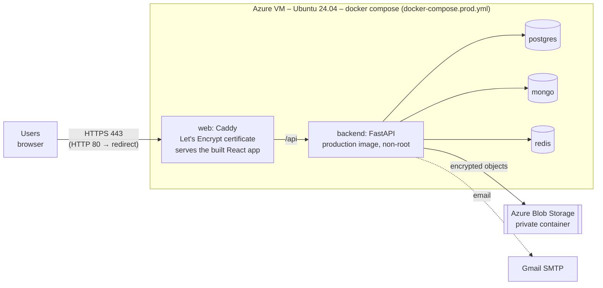

# TrustShare – Deployment Guide

How TrustShare runs in production: one small Azure virtual machine running the stack with Docker
Compose, behind Caddy with a free, automatically renewed HTTPS certificate. Encrypted files are
stored in Azure Blob Storage.

- **Cost:** designed for **Azure for Students** – the B1s VM is in the free services for 12 months,
  and the account has no credit card, so nothing can be charged; the small remaining costs (public
  IP, blob storage) come out of the free credit.
- **Time:** about 45 minutes the first time.

## Contents

1. [Production architecture](#1-production-architecture)
2. [What changes in production](#2-what-changes-in-production)
3. [Create the virtual machine](#3-create-the-virtual-machine)
4. [Prepare the server](#4-prepare-the-server)
5. [Configure and start TrustShare](#5-configure-and-start-trustshare)
6. [After the first start](#6-after-the-first-start)
7. [Operating the server](#7-operating-the-server) – updates, backups, costs
8. [Troubleshooting](#8-troubleshooting)
9. [Testing the production setup locally](#9-testing-the-production-setup-locally)

## 1. Production architecture



Only ports **80** and **443** (and **22** for SSH, limited to your IP address) are open on the VM.
The databases and the backend are reachable only inside the private Docker network.

## 2. What changes in production

| | Development (`docker-compose.yml`) | Production (`docker-compose.prod.yml`) |
|---|---|---|
| Web app | Vite dev server with live reload | Built once (`npm run build`) and served by Caddy (`frontend/Dockerfile.prod`) |
| Backend | Dev image with test tools, code mounted, `--reload` | Lean image with runtime packages only, code copied in, non-root user (`backend/Dockerfile.prod`) |
| HTTPS | Caddy's local certificate on `https://localhost:8443` | Free **Let's Encrypt** certificate for the real domain, renewed automatically, HTTP → HTTPS redirect (`caddy/Caddyfile.prod`) |
| Security headers | Backend headers | Plus **Content-Security-Policy**, **HSTS**, Permissions-Policy |
| Open ports | Databases on `127.0.0.1` for local tools | Only 80 / 443; no database or backend port published |
| Cookies | `COOKIE_SECURE=false` (HTTP allowed) | `COOKIE_SECURE=true` (refresh cookie only over HTTPS) |
| File storage | RustFS (local S3) or Azure | Azure Blob Storage, separate container `trustshare-files-prod` |
| Memory | Defaults | Tuned for 1 GB: MongoDB cache 0.25 GB, PostgreSQL 64 MB buffers, Redis capped at 96 MB, 1 backend worker |
| API docs (`/docs`) | Open on port 8000 | Not reachable from outside (only `/api/*` is forwarded) |
| Health checks | – | Databases must be healthy before the backend starts; every container restarts automatically |

Settings template: [`.env.production.example`](../.env.production.example).

## 3. Create the virtual machine

All in the Azure portal (https://portal.azure.com), signed in with your Azure for Students account.

### 3.1 Check that the VM size is free

Open **Free services** (search for it in the top bar). Under **Linux Virtual Machines** you should see
**B1s** with *750 hours per month*. Create the VM from there (**Create**) so the free size is
preselected – or follow the steps below and choose B1s yourself.

### 3.2 Create it

**Virtual machines → Create → Azure virtual machine.**

| Tab | Setting | Value |
|---|---|---|
| Basics | Resource group | **Create new** → `trustshare-rg` |
| | Virtual machine name | `trustshare-vm` |
| | Region | The same region as your storage account (e.g. **Central India**) |
| | Image | **Ubuntu Server 24.04 LTS – x64 Gen2** |
| | Size | **B1s** (1 vCPU, 1 GiB) – it shows *Free services eligible* |
| | Authentication type | **SSH public key**, username `azureuser`, key source **Generate new key pair**, name `trustshare-vm_key` |
| | Public inbound ports | **Allow selected ports** → **SSH (22), HTTP (80), HTTPS (443)** |
| Disks | OS disk type | **Standard SSD** (keep the default 30 GiB) |
| Networking | Public IP | New (default) – tick **Delete public IP and NIC when VM is deleted** |
| Management | Auto-shutdown | Optional – off for a site that should stay online |
| Monitoring | Boot diagnostics | Disable (not needed) |

**Review + create** → check the price shown is covered by free services → **Create**.
When asked, **Download private key and create resource** – keep `trustshare-vm_key.pem` safe (with
your secrets, never in Git).

### 3.3 Give the VM a web address

**trustshare-vm → Overview → DNS name → Not configured** (opens the public IP) →
**DNS name label** `trustshare-<yourname>` → **Save**.

The site address is now `trustshare-<yourname>.<region>.cloudapp.azure.com` – this is the `DOMAIN`.

### 3.4 Limit SSH to your own IP (recommended)

**trustshare-vm → Networking → Network settings** → the inbound rule for port **22** → **Source:
My IP address** → **Save**. Ports 80 and 443 stay open to everyone.

## 4. Prepare the server

### 4.1 Connect

On Windows (PowerShell), first make the key readable only by you, then connect:

```powershell
icacls "$HOME\Downloads\trustshare-vm_key.pem" /inheritance:r /grant:r "$($env:USERNAME):R"
ssh -i "$HOME\Downloads\trustshare-vm_key.pem" azureuser@trustshare-<yourname>.<region>.cloudapp.azure.com
```

Type `yes` the first time. Everything below runs **on the VM**.

### 4.2 Add swap space

1 GB of RAM is tight while building the images; swap gives the system extra room on disk.

```bash
sudo fallocate -l 4G /swapfile && sudo chmod 600 /swapfile
sudo mkswap /swapfile && sudo swapon /swapfile
echo '/swapfile none swap sw 0 0' | sudo tee -a /etc/fstab
free -h      # "Swap: 4.0Gi" expected
```

### 4.3 Install Docker

Docker's official repository for Ubuntu:

```bash
sudo apt-get update && sudo apt-get install -y ca-certificates curl git
sudo install -m 0755 -d /etc/apt/keyrings
sudo curl -fsSL https://download.docker.com/linux/ubuntu/gpg -o /etc/apt/keyrings/docker.asc
echo "deb [arch=$(dpkg --print-architecture) signed-by=/etc/apt/keyrings/docker.asc] https://download.docker.com/linux/ubuntu $(. /etc/os-release && echo $VERSION_CODENAME) stable" | sudo tee /etc/apt/sources.list.d/docker.list
sudo apt-get update && sudo apt-get install -y docker-ce docker-ce-cli containerd.io docker-compose-plugin
sudo usermod -aG docker $USER
exit
```

Connect again (so the group change applies) and check: `docker run --rm hello-world`.

Ubuntu installs security updates automatically (`unattended-upgrades` is on by default).

## 5. Configure and start TrustShare

### 5.1 Get the code

```bash
git clone https://github.com/Vimaladharsan/TrustShare-Encrypted-File-Sharing-Collaboration-Platform.git trustshare
cd trustshare
```

### 5.2 Create the production settings

```bash
cp .env.production.example .env
nano .env
```

Fill in every `change-me` and the address lines:

| Setting | Value |
|---|---|
| `DOMAIN` | `trustshare-<yourname>.<region>.cloudapp.azure.com` |
| `ACME_EMAIL` | Your email (Let's Encrypt notices) |
| `FRONTEND_URL` | `https://<DOMAIN>` |
| `GOOGLE_REDIRECT_URI` | `https://<DOMAIN>/api/auth/google/callback` |
| `POSTGRES_PASSWORD`, `MONGO_PASSWORD`, `REDIS_PASSWORD` | New random values (below) |
| `JWT_SECRET` | New random value |
| `MFA_ENCRYPTION_KEY`, `MASTER_KEYS` | New keys (below) |
| `SMTP_USER`, `SMTP_PASSWORD` | The Gmail sender and its app password |
| `GOOGLE_CLIENT_ID`, `GOOGLE_CLIENT_SECRET` | From Google Cloud Console |
| `AZURE_STORAGE_CONNECTION_STRING` | Storage account → Access keys → Connection string |

Generate random values on the VM:

```bash
python3 -c "import secrets; print(secrets.token_urlsafe(32))"                        # passwords, JWT_SECRET
python3 -c "import base64, os; print(base64.urlsafe_b64encode(os.urandom(32)).decode())"  # MFA_ENCRYPTION_KEY
python3 -c "import base64, os; print('1:' + base64.b64encode(os.urandom(32)).decode())"   # MASTER_KEYS
```

> **Keep a copy of `.env` somewhere safe** (outside Git). If `MASTER_KEYS` is lost, the encrypted
> files can never be decrypted again – that is the point of the encryption.

Production starts with **its own empty databases and its own Azure container**; development data is
not copied.

### 5.3 Start

```bash
docker compose -f docker-compose.prod.yml up -d --build
```

The first build takes several minutes on a B1s (the React build is the slowest part). Then:

```bash
docker compose -f docker-compose.prod.yml ps        # all services Up; databases (healthy)
docker compose -f docker-compose.prod.yml logs web  # "certificate obtained successfully"
```

Open **https://&lt;DOMAIN&gt;** – the padlock shows a valid certificate.

## 6. After the first start

1. **Create the first admin** (the password is asked for and not shown):
   ```bash
   docker compose -f docker-compose.prod.yml exec backend python -m app.scripts.create_admin --email you@example.com --name "Admin"
   ```
2. **Google sign-in:** Google Cloud Console → APIs & Services → Credentials → the OAuth client →
   add `https://<DOMAIN>` to *Authorized JavaScript origins* and
   `https://<DOMAIN>/api/auth/google/callback` to *Authorized redirect URIs* → Save.
3. **Check:** `https://<DOMAIN>/api/health` shows `ok` for every service; register, upload, share a
   link and open it on your phone; sign in as admin and see *Integrity verified* on the audit log.

## 7. Operating the server

All commands run in `~/trustshare` on the VM.

| Task | Command |
|---|---|
| Status | `docker compose -f docker-compose.prod.yml ps` |
| Logs | `docker compose -f docker-compose.prod.yml logs -f backend` (or `web`, `mongo` …) |
| Memory | `free -h` and `docker stats --no-stream` |
| Update to the latest code | `git pull && docker compose -f docker-compose.prod.yml up -d --build` |
| Restart | `docker compose -f docker-compose.prod.yml restart` |
| Stop (data kept) | `docker compose -f docker-compose.prod.yml down` |

Database migrations run automatically when the backend starts.

### Backups

```bash
mkdir -p ~/backups
docker compose -f docker-compose.prod.yml exec -T postgres sh -c 'pg_dump -U "$POSTGRES_USER" "$POSTGRES_DB"' > ~/backups/postgres-$(date +%F).sql
docker compose -f docker-compose.prod.yml exec -T mongo sh -c 'mongodump -u "$MONGO_INITDB_ROOT_USERNAME" -p "$MONGO_INITDB_ROOT_PASSWORD" --authenticationDatabase admin --archive --gzip' > ~/backups/mongo-$(date +%F).archive.gz
```

Copy backups off the VM (e.g. `scp` to your laptop). A complete restore needs the database dumps,
the Azure container **and** the `.env` with the master keys.

### Keeping it free

- **Cost Management** in the portal shows the credit used so far.
- To pause the site without losing anything: **trustshare-vm → Stop**. A stopped (deallocated) VM
  costs almost nothing; **Start** brings everything back (containers restart on their own). The
  public IP and DNS name stay the same.
- Don't add resources that aren't marked as free.

## 8. Troubleshooting

| Problem | Fix |
|---|---|
| No certificate / browser warning on the real domain | `docker compose -f docker-compose.prod.yml logs web`. Ports 80 and 443 must be open in the VM's networking rules, and `DOMAIN` must match the DNS name exactly |
| `502 Bad Gateway` right after starting | The backend is still applying migrations – wait a minute; then check `logs backend` |
| Build stops with "killed" / out of memory | Check swap is on (`free -h`); build again |
| Site slow, containers restarting | `docker stats --no-stream`; set `WEB_WORKERS=1` (default) or resize the VM to **B1ms** (2 GB – uses more credit) |
| Google sign-in error `redirect_uri_mismatch` | The URI in Google Cloud Console must equal `GOOGLE_REDIRECT_URI` exactly, with `https://` |
| Emails link to the wrong address | `FRONTEND_URL` must be `https://<DOMAIN>`; restart the backend after changing `.env` |
| SSH times out | The port 22 rule only allows your old IP – update it to *My IP address* |
| `/api/health` shows `storage: error` | Check `AZURE_STORAGE_CONNECTION_STRING`; the container is created automatically |

## 9. Testing the production setup locally

The production stack can be tried on a laptop before deploying. It uses separate Docker volumes,
so development data is untouched. With `DOMAIN=localhost`, Caddy uses its own local certificate.

```bash
DOMAIN=localhost ACME_EMAIL=test@example.com docker compose -f docker-compose.prod.yml up -d --build
# open https://localhost  (accept the local certificate warning)
DOMAIN=localhost ACME_EMAIL=test@example.com docker compose -f docker-compose.prod.yml down -v
```

Ports 80 and 443 must be free. GitHub Actions also builds both production images and validates the
compose file and Caddyfile on every push.

**Verified locally before the first deployment (19 Nov 2026):** all services healthy, HTTP → HTTPS
redirect, security headers present, only ports 80/443 published, browser sweep of every page with no
Content-Security-Policy violations, PDF preview, live notification stream, idle memory of the whole
stack ≈ 580 MB with two backend workers (production uses one on a 1 GB VM).
